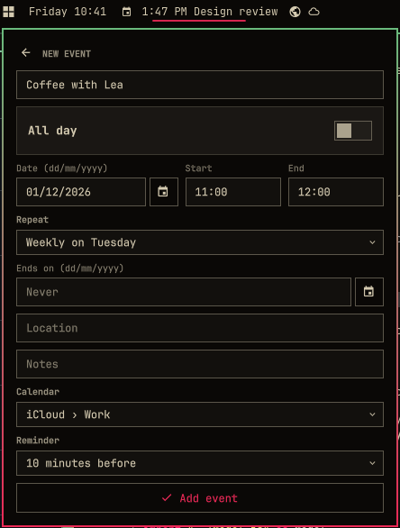

# Agenda pour Omarchy

*[Read in English](README.md)*

<p align="center"></p>

Tes calendriers dans la barre d'Omarchy, sous forme de plugin séparé : l'horloge
d'origine n'est pas modifiée.

- **Dans la barre** : ce qui se passe maintenant ou juste après (« Standup dans
  12 min », « 14:30 Dentiste »). S'il n'y a rien de prévu, seule l'icône du
  calendrier s'affiche.
- **Popup agenda** : aujourd'hui et les jours suivants, avec une couleur par
  calendrier et un bouton Rejoindre pour Meet, Zoom, Teams et les autres
  liens de visio.
- **Ajouter et supprimer des événements** : ajout rapide (« Dentiste demain
  14h-15h ») ou formulaire complet. Pour un événement récurrent, le plugin
  demande s'il faut supprimer cet événement seulement ou toute la série.
- **Rappels synchronisés** : les rappels réglés sur chaque événement (sur le
  téléphone, sur le web ou ici) deviennent des notifications sur le bureau.
  Elles ont des boutons Rejoindre, Rappeler dans 5 min et Ouvrir, et aucun
  rappel n'est envoyé deux fois.
- **Récap du jour** à l'ouverture de session, et au réveil de l'ordinateur
  si on a changé de jour.
- Suit la langue (français et anglais inclus) et le thème d'Omarchy.

| Fournisseur | État | Accès |
|---|---|---|
| Apple iCloud | ✅ | lecture et écriture |
| Tout serveur CalDAV (Fastmail, Nextcloud, Zoho, Yahoo, mailbox.org, Radicale…) | ✅ | lecture et écriture |
| Google | ✅ | lecture et écriture (ton propre client OAuth, environ 5 minutes une seule fois) |
| Liens `.ics` / `webcal` (adresse secrète Google ou Proton, jours fériés…) | ✅ | lecture seule |
| Microsoft / Outlook | prévu | lecture et écriture (ta propre app Azure) |

## Captures

| Détails d'un événement | Nouvel événement |
|---|---|
|  |  |

| Comptes | Réglages |
|---|---|
|  |  |

*Toutes les captures utilisent des événements inventés (voir « Mode démo » plus bas).*

## Installation

```bash
omarchy plugin add https://github.com/dadoux01/omarchy-agenda --enable
```

Le widget s'installe à droite de la barre. Pour le mettre juste à côté de l'horloge :

```bash
omarchy bar move dadoux01.agenda --section centerEnd
```

Tu peux aussi placer ce dossier dans `~/.config/omarchy/plugins/dadoux01.agenda/`
puis lancer `omarchy plugin enable dadoux01.agenda --section centerEnd`.

Le plugin a besoin de `python3`, déjà fourni par Omarchy. `secret-tool`
(libsecret) et `notify-send` (libnotify) sont facultatifs mais recommandés.
Rien d'autre n'est installé : le service n'utilise que la bibliothèque
standard de Python.

## Désinstallation

1. Facultatif, pour supprimer aussi les mots de passe enregistrés : ouvre
   **Comptes** et retire chaque compte. Ça supprime son entrée du trousseau.
2. Retire le plugin :

   ```bash
   omarchy plugin remove dadoux01.agenda
   ```

3. Facultatif, pour supprimer ses réglages, son cache et tout secret restant :

   ```bash
   rm -rf ~/.config/dadoux01.agenda ~/.local/state/dadoux01.agenda
   secret-tool clear service dadoux01.agenda
   ```

Rien n'est jamais supprimé de tes calendriers sur les serveurs.

## Connecter un calendrier

Clique sur l'icône du calendrier dans la barre, puis sur **Connecter un
calendrier** :

- **iCloud** : voir [docs/icloud.fr.md](docs/icloud.fr.md). Il faut un *mot de
  passe pour app*, pas celui de l'identifiant Apple.
- **Google** : voir [docs/google.fr.md](docs/google.fr.md). Tu crées ton propre
  client OAuth dans Google Cloud, environ 5 minutes une seule fois ; le
  plugin n'embarque aucun identifiant Google.
- **Autre CalDAV** : voir [docs/caldav.fr.md](docs/caldav.fr.md).
- **Un lien de calendrier** (`.ics`, `webcal://`) : voir [docs/ics.fr.md](docs/ics.fr.md).

Choisis les calendriers à afficher, et c'est terminé. Tu pourras ensuite
ajouter, masquer ou retirer des comptes dans **Comptes** (l'icône des
personnes).

## Utilisation

| Action | Souris | Clavier (popup ouvert) |
|---|---|---|
| Ouvrir l'agenda | clic gauche | `omarchy-shell dadoux01.agenda toggle` |
| Nouvel événement | clic droit, ou `+` | `n` |
| Ajout rapide | taper dans le champ en haut | `/` |
| Synchroniser | clic du milieu, ou l'icône de synchro | `s` |
| Parcourir les événements | | `↑` `↓` (ou `j` `k`) |
| Voir les détails | cliquer sur l'événement | `Entrée` |
| Rejoindre la visio | **Rejoindre** | `o` ou `J` sur l'événement sélectionné |
| Supprimer | **Supprimer** dans les détails | `Suppr` ou `x` |
| Comptes / Réglages | icônes en haut | `a` / `,` |
| Retour / fermer | | `Échap` |

Pour un raccourci clavier, ajoute ceci dans `~/.config/hypr/bindings.lua` :

```lua
o.bind("SUPER + C", "Agenda", "omarchy-shell dadoux01.agenda toggle")
```

La cible IPC accepte aussi `open`, `add` et `sync`.

### Ajout rapide

L'analyseur comprend le français et l'anglais. Il repère un jour et une
heure, et tout le reste devient le titre.

| Tu tapes | Tu obtiens |
|---|---|
| `Dentiste demain 14h-15h` | demain 14:00–15:00 |
| `Call vendredi à 9h` | vendredi prochain 09:00–10:00 |
| `Réunion 28/11 10:30` | 28 novembre 10:30–11:30 |
| `Vacances 24/12` | 24 décembre, toute la journée |
| `Lunch tomorrow 1pm-2pm` | demain 13:00–14:00 |

Si le texte ne contient ni date ni heure reconnaissable, le formulaire
s'ouvre avec ton texte comme titre.

## Réglages

Sous l'icône engrenage :

- **Rappels du calendrier** : notifie les rappels propres à chaque événement.
- **Notifier au début d'un événement** : avec un bouton Rejoindre si
  l'événement a un lien de visio.
- **Rappel en plus sur cet ordinateur**, en plus des rappels de l'événement.
- **Notifications discrètes** : masque les titres et les lieux, pratique sur
  un écran partagé.
- **Récap du jour**, activé ou désactivé.
- **Rappel par défaut des nouveaux événements**, **fréquence de synchro** et
  **jours affichés**.

Dans les réglages du widget de la barre, tu peux choisir d'afficher ou non
le prochain événement, et la longueur maximale d'un titre.

Un rappel manqué pendant que l'ordinateur était en veille ou éteint est
quand même envoyé s'il date de moins de 15 minutes, avec la mention *en
retard*. Les plus anciens sont ignorés, pour ne pas t'inonder au réveil.

## Confidentialité et sécurité

Tes données circulent uniquement entre cet ordinateur et les serveurs de
calendrier que tu connectes. Il n'y a aucun serveur intermédiaire, aucune
télémétrie et aucun paquet tiers. Les mots de passe sont rangés dans le
trousseau du système. Les détails sont dans [docs/security.fr.md](docs/security.fr.md).

## Fichiers

| Chemin | Contenu |
|---|---|
| `~/.config/dadoux01.agenda/accounts.json` | comptes et calendriers (sans mot de passe) |
| `~/.config/dadoux01.agenda/settings.json` | tes réglages |
| `~/.local/state/dadoux01.agenda/cache.json` | cache des événements, pour le hors-ligne |
| `~/.local/state/dadoux01.agenda/fired.json` | rappels déjà envoyés |
| trousseau système, `service=dadoux01.agenda` | mots de passe, connexion Google, liens de calendrier privés |

## Dépannage

- **Google : « a déconnecté ce compte » chaque semaine** : c'est normal tant
  que ton app OAuth est en mode *Test*. Clique sur **Comptes › Se
  reconnecter** ([docs/google.fr.md](docs/google.fr.md), étape 3).
- **« Identifiant ou mot de passe incorrect »** sur iCloud : utilise un mot
  de passe pour app, et active la double authentification sur l'identifiant
  Apple.
- **Le widget n'affiche rien** : lance `omarchy plugin list` et vérifie que
  `dadoux01.agenda` est activé.
- **« Le service Agenda ne tourne pas »** : vérifie que `python3` fonctionne.
  Les erreurs du service sont dans le journal du shell :
  `grep agenda /run/user/$UID/quickshell/by-pid/*/log.log`.
- **Pas de notification** : lance **Réglages › Envoyer une notification de
  test**, et vérifie que Ne pas déranger est désactivé.

## Limites

- Les comptes Microsoft / Outlook ne sont pas encore pris en charge. Un
  calendrier Outlook publié fonctionne en lecture seule, comme lien `.ics`.
- Tant que ton app OAuth Google est en mode *Test*, Google déconnecte Agenda
  tous les 7 jours, et tu cliques sur **Comptes › Se reconnecter**.
- Les événements récurrents sont dépliés localement. Les règles quotidiennes,
  hebdomadaires, mensuelles et annuelles sont gérées, avec les exceptions et
  les occurrences déplacées. Les parties rares `BYWEEKNO`, `BYYEARDAY` et
  `BYHOUR` sont ignorées.
- L'interface est en anglais et en français. Les autres langues d'Omarchy
  retombent sur l'anglais ; les traductions sont bienvenues
  (`i18n/<code>.json`).
- On peut ajouter et supprimer des événements, pas encore les modifier.

## Développement

```bash
python3 -m unittest discover -s backend/tests   # analyseur, récurrences, CalDAV, rappels
node --test tests/                               # ajout rapide, regroupement, libellé de la barre
omarchy plugin validate .
```

Avant une version, passe les [tests manuels](docs/manual-tests.fr.md).

### Mode démo

Pour faire des captures sans le vrai agenda de personne, copie
[docs/demo.json](docs/demo.json) dans `~/.local/state/dadoux01.agenda/demo.json`
puis lance `omarchy restart shell`. Le service affiche alors ces comptes et
événements inventés, avec des horaires relatifs à aujourd'hui. Il ne contacte
aucun serveur, n'écrit rien et n'envoie aucun rappel. Supprime le fichier et
redémarre le shell pour retrouver tes calendriers.

## Licence

MIT
