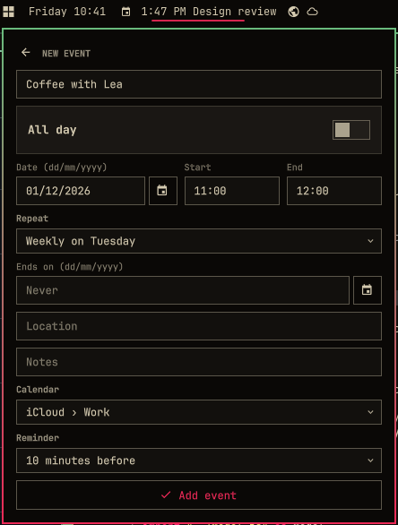

# Agenda for Omarchy

*[Lire en français](README.fr.md)*

<p align="center"></p>

Your calendars in the Omarchy bar, as a separate plugin that leaves the
built-in clock untouched.

- **Bar label**: what is on now or next ("Standup in 12 min", "14:30 Dentist").
  When nothing is coming up, only the calendar icon shows.
- **Agenda popup**: today and the next days, colour-coded per calendar, with
  a Join button for Meet, Zoom, Teams and other video links.
- **Add and delete events**: quick add ("Dentist tomorrow 2pm-3pm",
  "Dentiste demain 14h-15h") or a full form. The form can make the event
  repeat (daily, every weekday, weekly, monthly, yearly), forever or until a
  date. Deleting a repeating event asks
  whether to delete one event or the whole series.
- **Synced reminders**: the reminders set on each event (on your phone, on
  the web, or here) become desktop notifications. They have Join, Snooze and
  Open buttons, and no reminder is sent twice.
- **Daily recap** at login, and when the computer wakes up on a new day.
- Follows the Omarchy language (English and French included) and theme.

| Provider | Status | Access |
|---|---|---|
| Apple iCloud | ✅ | read and write |
| Any CalDAV server (Fastmail, Nextcloud, Zoho, Yahoo, mailbox.org, Radicale…) | ✅ | read and write |
| Google | ✅ | read and write (your own OAuth client, about 5 minutes once) |
| `.ics` / `webcal` links (Google or Proton secret address, holidays…) | ✅ | read only |
| Microsoft / Outlook | planned | read and write (your own app registration) |

## Screenshots

| Event details | New event |
|---|---|
|  |  |

| Accounts | Settings |
|---|---|
|  |  |

*All screenshots use made-up events (see "Demo mode" below).*

## Install

```bash
omarchy plugin add https://github.com/dadoux01/omarchy-agenda --enable
```

The widget lands on the right of the bar. To put it next to the clock:

```bash
omarchy bar move dadoux01.agenda --section centerEnd
```

Or put this folder at `~/.config/omarchy/plugins/dadoux01.agenda/` and run
`omarchy plugin enable dadoux01.agenda --section centerEnd`.

The plugin needs `python3`, which Omarchy ships. `secret-tool` (libsecret)
and `notify-send` (libnotify) are optional but recommended. Nothing else is
installed: the helper uses only the Python standard library.

## Uninstall

1. Optional, to also delete the saved passwords: open **Accounts** and
   remove each account. This deletes its keyring entry.
2. Remove the plugin:

   ```bash
   omarchy plugin remove dadoux01.agenda
   ```

3. Optional, to delete its settings, cache and any secret left behind:

   ```bash
   rm -rf ~/.config/dadoux01.agenda ~/.local/state/dadoux01.agenda
   secret-tool clear service dadoux01.agenda
   ```

Nothing is ever deleted from your calendars on the servers.

## Connect a calendar

Click the calendar icon in the bar, then **Connect a calendar**:

- **iCloud**: see [docs/icloud.md](docs/icloud.md). You need an
  *app-specific password*, not your Apple ID password.
- **Google**: see [docs/google.md](docs/google.md). You create your own
  OAuth client in Google Cloud, about 5 minutes once; the plugin ships no
  Google credentials.
- **Other CalDAV**: see [docs/caldav.md](docs/caldav.md).
- **A calendar link** (`.ics`, `webcal://`): see [docs/ics.md](docs/ics.md).

Pick the calendars to show, and you are done. Accounts can be added, hidden
or removed later under **Accounts** (the people icon).

## Use

| Action | Mouse | Keyboard (popup open) |
|---|---|---|
| Open the agenda | left click | `omarchy-shell dadoux01.agenda toggle` |
| New event | right click, or `+` | `n` |
| Quick add | type in the field at the top | `/` |
| Sync now | middle click, or the sync icon | `s` |
| Move through events | | `↑` `↓` (or `j` `k`) |
| Show details | click the event | `Enter` |
| Join the video call | **Join** | `o` or `J` on a selected event |
| Delete | **Delete** in the details | `Delete` or `x` |
| Accounts / Settings | icons at the top | `a` / `,` |
| Back / close | | `Esc` |

To bind a key, add this to `~/.config/hypr/bindings.lua`:

```lua
o.bind("SUPER + C", "Agenda", "omarchy-shell dadoux01.agenda toggle")
```

The IPC target also accepts `open`, `add` and `sync`.

### Quick add

The parser understands both French and English. It reads a day and a time,
and everything left over becomes the title.

| You type | You get |
|---|---|
| `Dentist tomorrow 2pm-3pm` | tomorrow 14:00–15:00 |
| `Dentiste demain 14h-15h` | tomorrow 14:00–15:00 |
| `Call friday at 9` | next Friday 09:00–10:00 |
| `Réunion 28/11 10:30` | 28 November 10:30–11:30 |
| `Holidays 24/12` | 24 December, all day |

When nothing in the text looks like a date or a time, the full form opens
with your text as the title.

## Settings

Under the cog icon:

- **Calendar reminders**: notify for each event's own reminders.
- **Notify when an event starts**: includes a Join button when the event
  has a video link.
- **Extra reminder on this computer**, on top of the event's own reminders.
- **Private notifications**: hide titles and places, for shared screens.
- **Daily recap** on or off.
- **Default reminder for new events**, **sync interval**, and **days shown**.

In the bar's widget settings, you can choose whether the next event is shown
and how long a title may get.

Reminders missed while the computer was asleep or off are still sent if they
are less than 15 minutes old, marked *late*. Older ones are skipped, so
waking the computer does not flood you.

## Privacy and security

Your data goes only between this computer and the calendar servers you
connect. There is no server of ours in the middle, no telemetry, and no
third-party package. Passwords are kept in the system keyring. The details
are in [docs/security.md](docs/security.md).

## Files

| Path | What |
|---|---|
| `~/.config/dadoux01.agenda/accounts.json` | accounts and calendars (no passwords) |
| `~/.config/dadoux01.agenda/settings.json` | your settings |
| `~/.local/state/dadoux01.agenda/cache.json` | events cache, for offline use |
| `~/.local/state/dadoux01.agenda/fired.json` | reminders already sent |
| system keyring, `service=dadoux01.agenda` | passwords, Google sign-in, private calendar links |

## Troubleshooting

- **Google: "signed this account out" every week**: expected while your
  OAuth app is in *Testing* mode. Click **Accounts › Sign in again**
  ([docs/google.md](docs/google.md), step 3).
- **"Wrong username or password"** on iCloud: use an app-specific password,
  and turn on two-factor authentication on the Apple ID.
- **The widget shows nothing**: run `omarchy plugin list` and check that
  `dadoux01.agenda` is enabled.
- **"The Agenda helper is not running"**: check that `python3` works. The
  helper's errors are in the shell log:
  `grep agenda /run/user/$UID/quickshell/by-pid/*/log.log`.
- **No notifications**: run **Settings › Send a test notification**, and
  make sure Do Not Disturb is off.

## Limitations

- Microsoft / Outlook accounts are not supported yet. A published Outlook
  calendar works as a read-only `.ics` link.
- While your Google OAuth app is in *Testing* mode, Google signs Agenda out
  every 7 days, and you click **Accounts › Sign in again**.
- Repeating events are expanded locally. Daily, weekly, monthly and yearly
  rules are supported, with exceptions and moved occurrences. The rare
  `BYWEEKNO`, `BYYEARDAY` and `BYHOUR` parts are ignored.
- The interface is in English and French. Other Omarchy languages fall back
  to English; translations are welcome (`i18n/<code>.json`).
- Events can be added and deleted, not edited yet.

## Development

```bash
python3 -m unittest discover -s backend/tests   # parser, recurrence, CalDAV, reminders
node --test tests/                               # quick add, grouping, bar label
omarchy plugin validate .
```

Before a release, run the [manual tests](docs/manual-tests.md).

### Demo mode

For screenshots without anyone's real calendar, copy
[docs/demo.json](docs/demo.json) to `~/.local/state/dadoux01.agenda/demo.json`
and run `omarchy restart shell`. The helper then shows those made-up
accounts and events, with times relative to today. It contacts no server,
writes nothing and sends no reminder. Delete the file and restart the shell
to get your calendars back.

## License

MIT
